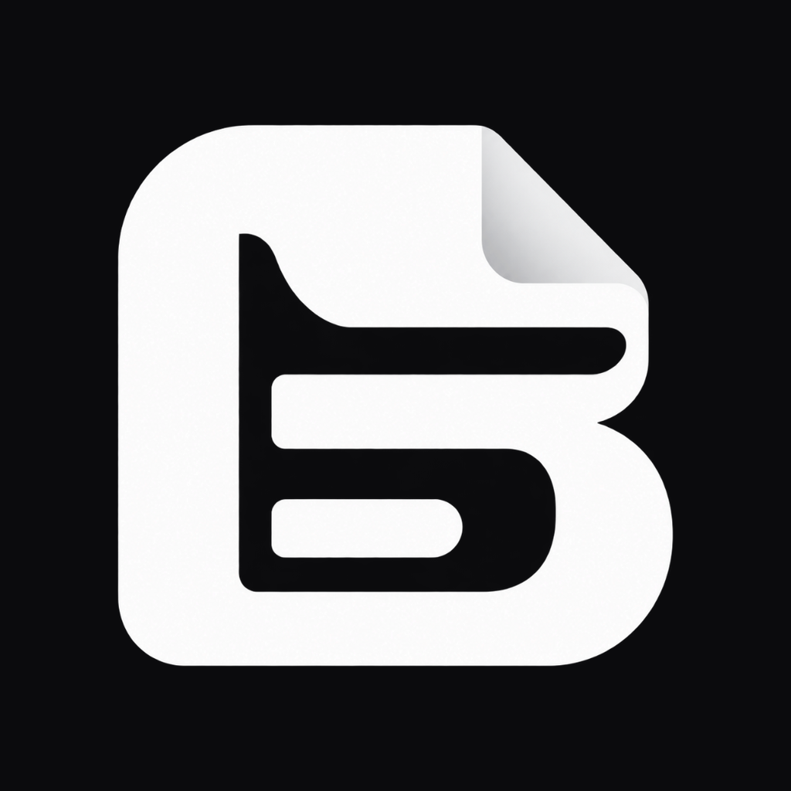

# Billframe ⚡

> **The Local-First, Zero-Subscription, AI-Powered Invoice & Statutory Business Operating System**  
> *The modern, 100% free & open-source alternative to Zoho Books, Zoho Invoice, and QuickBooks.*

<p align="center">
  
</p>

<p align="center">
  <a href="#license"></a>
  <a href="#local-first-architecture"></a>
  <a href="#why-billframe-vs-zoho--quickbooks"></a>
  <a href="#autonomous-ai-copilot"></a>
  <a href="#quickstart"></a>
</p>

---

## 🌟 Overview

**Billframe** is an enterprise-grade, local-first business operating system designed for freelancers, entrepreneurs, SMBs, and modern enterprises. While traditional SaaS giants lock your financial records behind expensive recurring paywalls, sell your accounting metadata, and grind to a halt during cloud outages, **Billframe runs 100% on your own device with zero subscriptions, zero trackers, and complete data sovereignty.**

Equipped with an **Autonomous AI Copilot**, Billframe understands natural language and statutory regulations. It autonomously reasons, calculates, and compiles compliant business documents—from CBIC GST Tax Invoices and Delivery Challans to Salary Slips, Commercial Quotations, and ATS-optimized Resumes.

---

## ⚔️ Why Billframe vs. Zoho & QuickBooks?

| Feature | **Billframe (Open Source)** | **Zoho Invoice / Books** | **QuickBooks Online** |
| :--- | :--- | :--- | :--- |
| **Pricing & Licensing** | **100% Free & Open Source (MIT)** | $15 to $240 / month per user | $30 to $200 / month |
| **Data Ownership** | **100% Local-First (On-Device SQLite)** | Cloud vendor locked | Cloud vendor locked |
| **Offline Reliability** | **Instantaneous offline execution** | Unusable without internet | Unusable without internet |
| **AI Copilot** | **Autonomous CoT Reasoning + 446 Docs** | None / Rigid rule scripts | Rudimentary categorization |
| **Data Elicitation** | **Interactive in-chatbox MCQ builder** | Static multi-page manual forms | Static multi-page manual forms |
| **Statutory Standards** | **CBIC GST 01–05, Rule 46/55, Sec 10(13A)** | Regional add-on fees | Regional add-on fees |
| **Financial Arithmetic** | **Deterministic BigInt Minor Units** | Floating-point rounding risk | Floating-point rounding risk |
| **POS & Thermal Printing** | **Built-in 80mm ESC/POS + Direct Print** | Requires third-party drivers | Requires expensive hardware bundles |
| **Privacy & Security** | **Zero trackers, Local biometric PIN** | Third-party analytics tracking | Telemetry & ad tracking |
| **Custom Templates** | **Visual Template Studio + Gold Masters** | Limited CSS customization | Restrictive templates |

---

## 🚀 Key Features

### 1. 🤖 Autonomous AI Document Copilot
- **446 Statutory Document Archetypes**: Covers 25 industry families including Commercial Billing, Logistics & Transport, HR & Payroll, Real Estate, Legal & Institutional, and Engineering Dossiers.
- **Cognitive Step-by-Step Reasoning**: Features a transparent, Claude-style thinking accordion (`Thought for 3s ⌵`) that shows intent classification, legal rule grounding, and mathematical derivations.
- **Interactive In-Chatbox MCQ Elicitation**: When statutory fields are missing, the AI smoothly slides up interactive multiple-choice cards in the chatbox (with options `[A]`, `[B]`, `[C]` and `[Other ✎]`), eliminating dummy placeholder data without tedious form filling.
- **Multi-Turn Context Memory**: References previous turns to seamlessly extract counterparties, candidate names, and line items.
- **Bring Your Own Key (BYOK) or 100% Offline**: Works out-of-the-box with lightning-fast Groq LPU (GPT-OSS 120B), Gemini 2.5 Flash, OpenAI, or 100% local deterministic heuristics with zero network connectivity.

### 2. 🧾 Complete CBIC GST & Statutory Invoicing Suite
- **Rule 46 B2B Tax Invoices**: Full GSTIN, PAN, HSN/SAC codes, reverse charge flags, and dual-state tax reconciliations.
- **Intra-State vs Inter-State Tax Engine**: Automatically splits tax into CGST + SGST or Integrated IGST based on the customer's Place of Supply.
- **Rule 55 Delivery Challans**: Formatted for goods transportation, job work, and supply on approval with transit valuations.
- **Rule 53 Credit & Debit Notes**: Seamless ledger adjustments and return reconciliations.
- **Commercial Quotations & Estimates**: Commercial validity periods, payment milestone schedules, and one-tap conversion into tax invoices.
- **5 Gold Standard GST Templates**:
  - `GST-01 Executive Letterhead`: Sleek typography with formal gold/black identity.
  - `GST-02 Structured Ledger`: Tabular double-entry accounting ledger format.
  - `GST-03 Minimal Professional`: Clean, high-density monochrome layout.
  - `GST-04 Corporate B2B`: Enterprise vendor billing with PO tracking.
  - `GST-05 Trade Supply Chain`: Logistics freight distribution with dispatch provenance.

### 3. 💼 HR, Payroll & Operations
- **Statutory Salary Slips**: Compliant with the *Payment of Wages Act 1936*, featuring itemized Gross Earnings and statutory deductions (EPF 12%, ESI, Professional Tax).
- **House Rent Receipts**: Fully formatted under *Section 10(13A) of the Income Tax Act 1961* for HRA tax exemption claims with Landlord PAN tracking.
- **ATS-Optimized Resumes & Dossiers**: Generates 98% ATS-scoring single-column resumes with structured skill matrices, quantified impact metrics, and zero parsing traps.
- **Field Engineering Work Orders**: Operational task lists, milestone deliverables, and authorized engineer sign-offs.

### 4. ⚡ Local-First SQLite & BigInt Math Engine
- **Deterministic Minor Units**: All monetary calculations are performed in integer minor units (paisa, cents) using `BigInt`, eliminating IEEE-754 floating-point rounding errors.
- **100% Local SQLite Database**: Powered by `expo-sqlite`, storing customers, catalog items, ledger balances, and documents locally on your device.
- **Optional Supabase Cloud Sync**: Encrypted peer-to-peer cloud sync for cross-device backup when you want it.

### 5. 🖨️ Hardware & Thermal POS Printing
- **80mm POS Thermal Receipts**: Instant itemized receipts for grocery stores, retail counters, and quick-service shops.
- **Zero-Blocker Printing**: Bulletproof cross-platform printing for web, Android, and iOS.
- **Vector UPI QR Codes**: Dynamic on-invoice QR codes for instant UPI / SEPA / bank wire settlements.

### 6. 🎨 Arctic Aurora Monochrome Design System
- Neutral-first, distraction-free executive interface (`#0D0E10` dark canvas, `#18191D` surfaces, `#F5F5F6` crisp typography).
- Responsive on mobile smartphones, tablets, and widescreen desktop monitors with split-pane live document preview.
- Fluid token cadence animations without bulky, congested container nesting.

---

## 🏗️ Architecture & Project Structure

```
billframe/
├── src/
│   ├── app/                      # Expo Router File-Based Routing
│   │   ├── (tabs)/               # Bottom Tab Navigation (Documents, Customers, Money, More)
│   │   ├── ai/assistant.tsx      # Autonomous AI Copilot & Conversational Document Studio
│   │   ├── document/[id].tsx     # Document Inspection, PDF Export & Printing
│   │   ├── document/edit.tsx     # Direct Document Form Editor
│   │   └── templates/studio.tsx  # Visual Statutory Template Studio
│   ├── components/
│   │   ├── ai/                   # AI UI (ChatboxAnimatedMcq, AnimatedArtifactTile, Thinking)
│   │   ├── animations/           # ClaudeThinkingIndicator, AuroraBackground, Shimmer
│   │   └── common/               # Design System Primitives (Buttons, Cards, Inputs, Badges)
│   ├── data/
│   │   ├── database/             # DatabaseManager, SQLite Schemas, MigrationRunner
│   │   └── repositories/         # Document, Customer, Catalog, BusinessProfile Repositories
│   ├── design/                   # Tokens, Arctic Aurora Color Families, Typography
│   ├── domain/
│   │   ├── documents/            # DocumentCalculator, StateMachine, Registry, 446 Catalogue
│   │   ├── money/                # Money Engine (BigInt Minor Units, Currency Registry)
│   │   └── tax/                  # TaxEngine, IndiaGstPack, GlobalCountryPacks
│   └── services/
│       ├── ai/                   # AiDocumentAgent, DocumentQuestionElicitor, RagRegistry
│       ├── pdf/                  # UniversalDocumentRenderer, GST 01-05 Templates
│       └── sync/                 # SupabaseSyncService & Local Backup Manager
├── android/                      # Native Android Project & Gradle Configuration
├── assets/                       # Branding Icons, Fonts & Statutory Logos
└── package.json                  # Dependencies & Project Metadata
```

---

## ⚡ Quickstart

### Prerequisites
- [Node.js](https://nodejs.org/) (v18.0 or newer)
- [npm](https://www.npmjs.com/) or [bun](https://bun.sh/)
- [Expo CLI](https://docs.expo.dev/) (`npx expo`)
- Optional: Android Studio (for native Android APK compilation)

### Installation

1. **Clone the repository:**
   ```bash
   git clone https://github.com/letscooktech-studio/billframe.git
   cd billframe
   ```

2. **Install dependencies:**
   ```bash
   npm install
   ```

3. **Start the development server:**
   ```bash
   # Launch Metro Bundler
   npx expo start

   # Launch Web Preview directly in browser
   npx expo start --web
   ```

4. **Run on Android Emulator or Physical Device:**
   ```bash
   npx expo run:android
   ```

5. **Build Release APK:**
   ```bash
   cd android
   ./gradlew assembleRelease
   ```
   The production-signed APK will be generated at:  
   `android/app/build/outputs/apk/release/app-release.apk`

---

## 💬 Using the AI Copilot

You can talk to the Billframe Copilot just like a human senior accountant. Tap the ✨ **AI Assistant** tab or prompt it directly:

- *"Draft a GST Tax Invoice for Acme Corp for 5 enterprise laptops at 60000 each with 18% GST"*
- *"Create a quotation and a delivery challan for Acme Corp for 5 enterprise laptops at 60000 each"*
- *"Build me complete highest ATS scoring resume for Farhan Noor for AI engineer"*
- *"Create a salary slip for John Doe, Senior Architect, basic 65,000, HRA 25,000, PF 3,600 for October 2026"*
- *"Generate a House Rent Receipt for tenant Rahul Sharma for 28,000 INR"*
- *"Draft me a complete grocery store cash memo with 10 random items"*

When statutory details are missing (such as Place of Supply, E-Way Bill numbers, or ATS candidate domain), the AI will interactively ask you with slide-up multiple-choice chips right inside the chatbox.

---

## 🤝 Contributing

We welcome contributions from developers, accountants, tax consultants, and open-source enthusiasts worldwide!

1. Fork the Project (`https://github.com/letscooktech-studio/billframe/fork`)
2. Create your Feature Branch (`git checkout -b feat/statutory-tax-pack`)
3. Commit your Changes (`git commit -m "feat: add Germany VAT statutory pack"`)
4. Push to the Branch (`git push origin feat/statutory-tax-pack`)
5. Open a Pull Request

---

## 📄 License

Distributed under the **MIT License**. Free for personal, commercial, and enterprise usage without restrictions. See [`LICENSE`](LICENSE) for details.

---

<p align="center">
  <b>Built with ❤️ by Let's Cook Tech Studio & the Global Open Source Community.</b><br/>
  <i>Your business. Your data. Zero subscriptions.</i>
</p>
