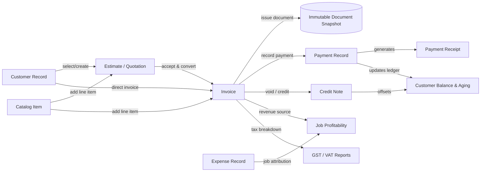

# BILLFRAME 2.0 — ARCHITECTURE AND UX AUDIT (UX-0)
**Document Version:** 2.0.0-AUDIT  
**Date:** October 8, 2026  
**Status:** Approved Architectural Blueprint & Baseline  
**Scope:** Billframe React Native / Expo Android Platform  

---

## 1. Executive Summary & Forensic Audit

Billframe is a local-first, sovereign business document operating workspace built with React Native 0.86, Expo 57, and SQLite. Core calculations use canonical `BigInt` minor units with zero floating-point math, backed by immutable document snapshots and localized tax/UPI engines.

The existing application is mathematically sound and stable (27/27 Jest test suites passing, 187/187 unit tests green, 0 TypeScript compile errors, and verified Android APK compilation). However, the user interface and navigation suffer from structural friction:
1. **Primary Navigation Inefficiency**: The current 5 tabs (`Home`, `Documents`, `Contacts`, `Money`, `Settings`) dedicate an entire tab to low-frequency Settings, while burying high-frequency operational tools like Jobs, Catalog, and Expenses inside secondary pages.
2. **Missing Master Directory**: Capabilities are scattered across different screens; users must guess where to find Aging, Catalog, or Tax Reports.
3. **Disconnected Business Workflows**: Navigating from a Customer record to creating an invoice for that specific customer, or from an Estimate to an Invoice, requires manual re-selection and multiple navigational jumps.
4. **Hardcoded Document Rendering**: While five PDF templates (`standard`, `compact`, `modern`, `executive`, `minimal`) exist in code, the document detail screen hardcodes `'standard'` with no UI for template discovery, real PDF preview, or branding customization.
5. **No Visual Document Studio**: Users cannot configure brand accent colors, fonts, visible table columns, payment QR placement, or signature blocks.

This document establishes the **Billframe 2.0** architecture, defining the **5-Tab Navigation Graph**, the **All Feature Directory**, the **Connected Workflow Engine**, the **Document Studio Architecture**, and the **Safe Migration Strategy**.

---

## 2. Route-by-Route Forensic Inventory

| Route | File Path | Status | Operational Capabilities | Identified UX/Navigation Issues |
|---|---|---|---|---|
| `/(tabs)/index` | `src/app/(tabs)/index.tsx` | Functional | Dashboard, receivables summary, recent documents, persona indicators | High visual density; lacks a dedicated "Today's Priorities" section; quick action buttons compete with cards. |
| `/(tabs)/documents` | `src/app/(tabs)/documents.tsx` | Functional | Documents list, search, type filters, status pills, UPI modal, payment modal | Focuses only on flat documents; does not provide sales workflow context or aging indicators. |
| `/(tabs)/contacts` | `src/app/(tabs)/contacts.tsx` | Functional | Client directory, search, call/email actions | Lacks customer balance pill in list view; vendor separation is absent. |
| `/(tabs)/money` | `src/app/(tabs)/money.tsx` | Functional | Outstanding totals, monthly collections, aging link, cash flow link | Overlaps significantly with Documents and Reports; fragments financial actions across tabs. |
| `/(tabs)/settings` | `src/app/(tabs)/settings.tsx` | Functional | Business profile, tax rates, payments, PIN, backup | Consumes a primary bottom navigation tab for configuration accessed infrequently. |
| `/(tabs)/customers` | `src/app/(tabs)/customers.tsx` | Hidden / Legacy | Legacy redirect | Hidden in tab bar (`href: null`); should be consolidated into canonical `/clients`. |
| `/(tabs)/more` | `src/app/(tabs)/more.tsx` | Hidden / Legacy | Legacy stub | Hidden in tab bar (`href: null`); will be replaced by canonical `/all` directory. |
| `/quick-bill` | `src/app/quick-bill.tsx` | Functional | 30-second POS counter billing, item picker, UPI QR, receipt | Standalone flow; lacks direct connection back to recent sales ledger or customer history. |
| `/document/edit` | `src/app/document/edit.tsx` | Functional | Invoice/Estimate editor, line item scaling, discount, tax, deposit | Very long scrolling form; needs section steppers or accordion organization for mobile. |
| `/document/[id]` | `src/app/document/[id].tsx` | Functional | Full detail view, issue/accept/void actions, UPI conversion, PDF export | Hardcodes PDF template to `'standard'`; lacks template picker and live layout preview. |
| `/customer/[id]` | `src/app/customer/[id].tsx` | Functional | Customer 360, total billed, balance, invoice list, statement generator | Missing contextual "New Invoice for this Customer" primary action bar. |
| `/customer/edit` | `src/app/customer/edit.tsx` | Functional | Customer creation and editing, tax ID, addresses | Standard form; lacks rapid inline validation feedback. |
| `/catalog/index` | `src/app/catalog/index.tsx` | Functional | Item/service list, pricing, tax selection, unit names | Buried under secondary routes; not easily accessible from primary navigation. |
| `/collections/index` | `src/app/collections/index.tsx` | Functional | Aging buckets (Current, 1-30, 31-60, 61-90, 90+), WhatsApp reminders | Highly useful for cash recovery, but hidden under Money tab. |
| `/expenses/index` | `src/app/expenses/index.tsx` | Functional | Expense ledger, category filtering, total calculations | Accessible only via secondary links. |
| `/expenses/add` | `src/app/expenses/add.tsx` | Functional | Expense entry form, category selector, receipt image attachment | Standalone form; lacks link back to specific job or client billing. |
| `/reports/index` | `src/app/reports/index.tsx` | Functional | Revenue, collections, tax breakdowns, expense summaries | Isolated; missing export to CSV/PDF from reports view. |
| `/receipt/[id]` | `src/app/receipt/[id].tsx` | Functional | Payment receipt detail, receipt PDF generation, share | High-quality visual receipt; needs direct link back to invoice. |
| `/backup` | `src/app/backup.tsx` | Functional | JSON backup export with SHA-256 verification, CSV export/import | Functional and secure; belongs in Data & Security section of All directory. |
| `/security-pin` | `src/app/security-pin.tsx` | Functional | PIN entry, biometric toggle, lock challenge | Fully functional; belongs in Settings & Support. |
| `/settings/payments` | `src/app/settings/payments.tsx` | Functional | UPI VPA setup, payee name, Razorpay API key configuration | Settings screen; belongs in Payments & Collections configuration. |
| `/settings/workspace` | `src/app/settings/workspace.tsx` | Functional | Persona selection (Freelancer, Contractor, Retail, etc.), layout lock | Settings screen; belongs in Personalization & Workspace section. |
| `/onboarding/setup` | `src/app/onboarding/setup.tsx` | Functional | Business profile setup, logo upload, country selection | Initial setup screen; accessible from Settings. |
| `/search` | `src/app/search.tsx` | Functional | Global search across documents, customers, items | Accessible via top search icon; functional. |

---

## 3. Billframe 2.0 Information Architecture (5-Tab Graph)

```mermaid
flowchart TD
    subgraph PrimaryTabs ["Canonical 5-Tab Navigation Shell"]
        HomeTab["1. Home\n(Command Center & Today's Priorities)"]
        SalesTab["2. Sales\n(Invoices, Estimates, Collections, Aging)"]
        ClientsTab["3. Clients\n(Customer 360, Balances, Statements)"]
        WorkTab["4. Work\n(Adaptive Business Workspace: Jobs, Catalog, Expenses)"]
        AllTab["5. All\n(Searchable Master Feature Directory & Settings)"]
    end

    HomeTab --> QuickBill["/quick-bill"]
    HomeTab --> NewDoc["/document/edit"]
    HomeTab --> DocDetail["/document/[id]"]
    HomeTab --> Search["/search"]

    SalesTab --> InvoicesList["Invoices Sub-view"]
    SalesTab --> EstimatesList["Estimates Sub-view"]
    SalesTab --> AgingCollections["/collections/index"]
    SalesTab --> ReceiptsList["Receipts Sub-view"]
    SalesTab --> NewDoc

    ClientsTab --> CustomerDetail["/customer/[id]"]
    ClientsTab --> CustomerEdit["/customer/edit"]
    CustomerDetail --> CustomerInvoices["Customer Invoices"]
    CustomerDetail --> CustomerStatement["Statement Modal"]
    CustomerDetail --> CreateForCustomer["Create Invoice for Customer"]

    WorkTab --> JobsSection["Jobs / Projects Ledger"]
    WorkTab --> CatalogSection["/catalog/index"]
    WorkTab --> ExpensesSection["/expenses/index"]
    WorkTab --> TimeSection["Time Tracking"]

    AllTab --> DirectorySearch["Live Feature Search"]
    AllTab --> CatSales["Sales & Documents"]
    AllTab --> CatPayments["Payments & Collections"]
    AllTab --> CatClients["Customers & Contacts"]
    AllTab --> CatOps["Business Operations"]
    AllTab --> CatAccounting["Accounting & Tax"]
    AllTab --> CatStudio["Document Studio (/templates)"]
    AllTab --> CatSecurity["Data & Security"]
    AllTab --> CatPersona["Personalization"]
    AllTab --> CatSettings["Settings & Support"]
```



### Destination Responsibilities

1. **HOME (`src/app/(tabs)/index.tsx`)**:
   - **Header**: Business identity, active persona badge, lock status, global search icon.
   - **Today's Priorities**: Overdue invoices needing follow-up, pending estimates awaiting approval, unbilled time/expenses.
   - **Financial Pulse**: Authoritative outstanding receivables, month-to-date collections, cash balance.
   - **Quick Actions Ribbon**: New Invoice, Quick Bill (30s), Record Payment, Add Expense.
   - **Recent Documents**: Chronological list of latest transactions with instant status pills.

2. **SALES (`src/app/(tabs)/sales.tsx`)**:
   - **Segmented Control**: All Sales, Invoices, Estimates / Quotes, Proformas, Receipts, Credit Notes.
   - **Status Filter**: All, Unpaid, Partially Paid, Paid, Overdue, Draft, Void.
   - **Action Bar**: "New Invoice", "New Estimate", "Quick Bill", "Collections & Aging".
   - **Receivables & Aging Summary**: Compact banner showing 1-30d, 31-60d, 61-90d, 90+d aging.
   - **Item Row**: Document number, customer name, date, total amount, balance due, payment status pill.

3. **CLIENTS (`src/app/(tabs)/clients.tsx`)**:
   - **Search & Sort**: Instant name/phone/email search, sorted by balance or alphabetical.
   - **Balance Overview**: Total outstanding across all debtors, active customer count.
   - **Client Card**: Name, business name, phone/email, total billed, current outstanding balance, status indicator.
   - **Client 360 Drilldown**: One tap to `/customer/[id]` with full history, statement generation, and direct call/WhatsApp.

4. **WORK (`src/app/(tabs)/work.tsx` — Adaptive Business Workspace)**:
   - Adapts to the user's business persona stored in SQLite (`business_profiles.business_type`):
     - **Contractor / Trades**: Jobs ledger, Work Orders, Time Entries, Project Expenses, Job Costing & Profitability.
     - **Retail / Storefront**: Fast Counter POS, Item Catalog with Stock/Price, Barcode Scanner, Daily Cash Register.
     - **Freelancer / Agency**: Active Client Projects, Proposals, Hourly Time Tracker, Expense Logging, Milestone Invoicing.
     - **Wholesale / B2B**: Product Price Lists, Delivery Notes, Bulk Order Invoicing, Debtors Ledger.
     - **Service Practice**: Service Menu, Client Retainers, Appointments/Jobs, Expense Ledger.
   - **Persona Switcher & Layout Lock**: Easily customize or manually select active workspace tools without auto-locking out other features.

5. **ALL (`src/app/(tabs)/all.tsx` — Master Feature Directory)**:
   - **Live Search Bar**: Real-time filtering across all features, document types, tools, and settings.
   - **9 Categorized Hubs**:
     1. *Sales & Documents*: Invoices, Estimates, Quick Bill, Proformas, Credit Notes, Delivery Challans.
     2. *Payments & Collections*: Record Payment, Payment Ledger, Aging & Collections, Payment Gateways & UPI Setup.
     3. *Customers & Contacts*: Client Directory, New Client, Customer Statements, Advance Deposits.
     4. *Business Operations*: Jobs / Projects, Product Catalog, Time Tracking, Expenses Ledger.
     5. *Accounting & Tax*: Tax Reports & E-Invoice, Regional Tax Packs (GST/VAT), Cash Flow Reports, Balance Ledger.
     6. *Document Studio*: Template Gallery, Customizer, Brand Colors & Fonts, Column Configuration, Signatures.
     7. *Data & Security*: Backup to Local Storage, Restore Database, CSV Data Export/Import, Audit Trail Ledger.
     8. *Personalization*: Business Persona Selection, Workspace Layout Lock, Default Currencies & Terms.
     9. *Settings & Support*: Business Profile Setup, PIN & Biometric App Lock, About & Sovereign Privacy.

---

## 4. Business-Type Workflow Matrix

| Business Persona | Primary Daily Need | Primary Screen Flow | Work Tab Highlights | Recommended Document Template |
|---|---|---|---|---|
| **Freelancer / Consultant** | Proposal $\rightarrow$ Invoice $\rightarrow$ Direct UPI / Bank Transfer | Home $\rightarrow$ New Estimate $\rightarrow$ Client Approval $\rightarrow$ Convert to Invoice $\rightarrow$ Share WhatsApp with UPI | Time Tracking, Proposals, Project Expenses | *Minimal* or *Modern* (clean, branded, typography-focused) |
| **Agency / Studio** | Milestone billing, multi-item proposals, retainer statements | Clients $\rightarrow$ Customer 360 $\rightarrow$ Milestone Invoice $\rightarrow$ Statement $\rightarrow$ Payment | Client Projects, Retainers, Subcontractor Costs | *Executive* (corporate, structured tables, tax breakdown) |
| **Contractor / Trades** | Quote $\rightarrow$ Job Costing $\rightarrow$ Progressive Invoices $\rightarrow$ Material Expenses | Work $\rightarrow$ New Job $\rightarrow$ Log Expenses $\rightarrow$ Progressive Invoice $\rightarrow$ Profit Margin | Jobs Ledger, Labour/Material Expenses, Time Entries | *Standard* or *Compact* (itemized quantities, unit specs) |
| **Retail / Storefront** | 30s walk-in billing, instant cash receipt, inventory prices | Home $\rightarrow$ Quick Bill $\rightarrow$ Cash/UPI $\rightarrow$ Instant Receipt Print | Counter POS, Product Catalog, Daily Cash Summary | *Compact* or *Receipt* (thermal POS / 80mm format) |
| **Wholesale / B2B** | Bulk catalog orders, credit terms, debtor aging follow-up | Sales $\rightarrow$ Bulk Invoice $\rightarrow$ Aging Hub $\rightarrow$ Payment Reminders | Product Catalog, Delivery Notes, Customer Statements | *Executive* (full HSN/tax columns, bank details, terms) |
| **Professional Practice** | Retainers, consultations, formal receipts, compliance | Clients $\rightarrow$ Retainer Invoice $\rightarrow$ Payment Record $\rightarrow$ Official Receipt | Client Consultations, Receipts, Tax Reports | *Standard* (legal entity name, tax registration, signature) |

---

## 5. Feature Dependency & Data Lineage Graph



### Data Lineage Integrity Rules
1. **Immutable Snapshots**: Once an Invoice or Estimate transitions from `draft` to `issued`, `SnapshotBuilder` serializes the seller details, buyer details, item calculations, tax rates, and totals into `document_snapshots`. Subsequent modifications to the customer or business profile NEVER rewrite issued documents.
2. **Canonical Financial Core**: All monetary values are strictly `bigint` minor units (e.g. cents, paise). No floating-point multiplication or division is permitted in calculating subtotals, taxes, discounts, or balances.
3. **Ledger-Derived Balances**: Payment status (`unpaid`, `partially_paid`, `paid`) is strictly derived from the sum of payments and deposits recorded against the document, never from a manually toggled status flag.
4. **Zero Duplication**: Converting an Estimate to an Invoice preserves the original estimate ID in `converted_from_id` and does not clone line items into duplicate independent entities without lineage.

---

## 6. Component & Design Token Architecture

### Design Tokens (`src/design/tokens.ts`)
- **Spacing Scale**: `xs: 4`, `sm: 8`, `md: 12`, `lg: 16`, `xl: 20`, `xxl: 24`, `xxxl: 32`.
- **Radii**: `xs: 4`, `sm: 8` (buttons/inputs), `md: 12` (cards), `lg: 16` (sheets), `pill: 9999` (status tags).
- **Minimum Touch Target**: `MIN_TOUCH_TARGET = 48dp` (strictly enforced across all interactive elements for Android accessibility).
- **Color Palettes**:
  - Light: Background `#F7F7F6`, Surface `#FFFFFF`, SurfaceSecondary `#EFEFED`, Border `#E5E5E3`, TextPrimary `#171717`, TextSecondary `#6B6B6B`, BrandAnchor `#171717`.
  - Dark: Background `#111111`, Surface `#181818`, SurfaceSecondary `#222222`, Border `#2A2A2A`, TextPrimary `#F5F5F5`, TextSecondary `#A1A1A1`, BrandAnchor `#F5F5F5`.
  - Status: Draft `#6B6B6B`, Issued `#2563EB`, Success `#15803D`, Warning `#B45309`, Danger `#B91C1C`.

### Standardized Reusable UI Components
To ensure complete consistency across all workspaces, Billframe 2.0 uses centralized components:
1. **`AppHeader`**: Standardized top bar with optional back button, title, subtitle, right action, and elevation.
2. **`MetricCard`**: Financial highlight card displaying label, formatted money, supporting comparison, and accent color.
3. **`ActionTile` / `FeatureCard`**: 48dp+ interactive row with Lucide icon container, title, description, badge, and chevron.
4. **`StatusBadge`**: Pill tag rendering lifecycle statuses (`draft`, `issued`, `paid`, `unpaid`, `overdue`) with accessible contrast.
5. **`ContextActionBar`**: Floating or pinned bottom ribbon providing the primary next step (e.g. "Issue Document", "Record Payment", "Share PDF").
6. **`EmptyState`**: Professional placeholder featuring relevant Lucide icon, explanatory copy, and clear primary CTA.
7. **`SearchInput`**: Full-width search bar with clear button, instant debounce, and focus ring.

---

## 7. Document Studio Architecture

### Overview
Document Studio is Billframe's centralized document personalization and styling engine. It bridges the existing `PdfService` and template renderers with user-configurable branding, layout options, and typography.

### Schema Blueprint (SQLite)

```sql
-- 1. Document Template Definitions
CREATE TABLE IF NOT EXISTS template_definitions (
  id TEXT PRIMARY KEY NOT NULL,
  code TEXT UNIQUE NOT NULL,            -- 'standard', 'compact', 'modern', 'executive', 'minimal'
  name TEXT NOT NULL,                   -- 'Executive Blue', 'Modern Minimalist', etc.
  description TEXT NOT NULL,
  category TEXT NOT NULL,               -- 'general', 'corporate', 'pos', 'service'
  thumbnail_uri TEXT,
  default_config_json TEXT NOT NULL,    -- Default styling tokens
  is_system INTEGER NOT NULL DEFAULT 1,
  created_at INTEGER NOT NULL,
  updated_at INTEGER NOT NULL
);

-- 2. Template Customizations (Per Business Profile)
CREATE TABLE IF NOT EXISTS template_customizations (
  id TEXT PRIMARY KEY NOT NULL,
  template_code TEXT NOT NULL REFERENCES template_definitions(code) ON DELETE CASCADE,
  business_profile_id TEXT NOT NULL REFERENCES business_profiles(id) ON DELETE CASCADE,
  brand_color TEXT NOT NULL DEFAULT '#1E40AF',
  secondary_color TEXT NOT NULL DEFAULT '#64748B',
  font_family TEXT NOT NULL DEFAULT 'Inter, system-ui, sans-serif',
  logo_position TEXT NOT NULL DEFAULT 'left', -- 'left', 'center', 'right'
  show_logo INTEGER NOT NULL DEFAULT 1,
  show_tax_breakdown INTEGER NOT NULL DEFAULT 1,
  show_payment_qr INTEGER NOT NULL DEFAULT 1,
  show_signature INTEGER NOT NULL DEFAULT 1,
  show_terms INTEGER NOT NULL DEFAULT 1,
  custom_declaration TEXT,
  custom_footer_notes TEXT,
  column_visibility_json TEXT NOT NULL DEFAULT '{"hsn":true,"taxRate":true,"unit":true,"discount":true}',
  updated_at INTEGER NOT NULL,
  UNIQUE(template_code, business_profile_id)
);

-- 3. Document Type Template Assignments
CREATE TABLE IF NOT EXISTS template_assignments (
  id TEXT PRIMARY KEY NOT NULL,
  business_profile_id TEXT NOT NULL REFERENCES business_profiles(id) ON DELETE CASCADE,
  doc_type TEXT NOT NULL,               -- 'invoice', 'estimate', 'receipt', 'proforma', 'credit_note'
  template_code TEXT NOT NULL REFERENCES template_definitions(code) ON DELETE RESTRICT,
  updated_at INTEGER NOT NULL,
  UNIQUE(business_profile_id, doc_type)
);
```

### Rendering Pipeline
1. **Resolution**: `PdfService.generateDocumentHtml()` queries `template_assignments` for the active profile and document type.
2. **Customization Merge**: Loads `template_customizations` (brand color, fonts, column visibility, custom declaration).
3. **HTML Compilation**: Passes document data + merged branding configuration to the selected template compiler.
4. **Sanitization**: All user inputs (notes, legal names, terms) are HTML-escaped to prevent injection.
5. **Private Cost Protection**: Internal costs, contractor profit margins, and private notes are strictly excluded from customer PDF generation.
6. **Issued Immutability**: For issued documents, if a snapshot exists in `document_snapshots`, the PDF renders from the immutable snapshot data, ensuring retrospective edits to profile data never alter historical invoices.

---

## 8. Safe Migration & Backward Compatibility Plan

1. **Route Continuity**:
   - `src/app/(tabs)/documents.tsx` redirects seamlessly to `src/app/(tabs)/sales.tsx` or mounts the unified Sales view.
   - `src/app/(tabs)/contacts.tsx` redirects to `src/app/(tabs)/clients.tsx`.
   - `src/app/(tabs)/more.tsx` and `src/app/(tabs)/settings.tsx` redirect to `src/app/(tabs)/all.tsx`.
   - Deep links to `/document/[id]`, `/customer/[id]`, `/catalog/index`, `/backup`, and `/reports/index` remain 100% stable.
2. **Database Migration Safety**:
   - Migration runner checks `migration_history` table.
   - New tables for `template_definitions`, `template_customizations`, and `template_assignments` are added idempotently using `CREATE TABLE IF NOT EXISTS`.
   - Default system templates are seeded on first launch.
   - Zero changes to existing financial tables: `documents`, `document_items`, `document_snapshots`, `payments`, `customers`.

---

## 9. Baseline Verification & Metrics

- **TypeScript Compilation**: `npx tsc --noEmit` $\rightarrow$ 0 errors.
- **Jest Test Suite**: 27 test suites, 187 tests passing (100% pass rate).
- **Native Android APK**: Latest built binary `Billframe-Latest.apk` (259 MB), Android API 36 target, signed debug build.
- **Financial Arithmetic**: 100% verified integer minor unit operations via `Money.ts` and `DocumentCalculator.ts`.
- **Paywall Audit**: Confirmed zero paywalls, zero subscription gates, zero telemetry.

---

## 10. Phase UX-1 Implementation Roadmap

With Phase UX-0 complete and verified, the next implementation phase (**UX-1**) will execute:
1. **Tab Navigator Refactor (`src/app/(tabs)/_layout.tsx`)**: Mount the 5 canonical destinations:
   - `index` $\rightarrow$ Home
   - `sales` $\rightarrow$ Sales
   - `clients` $\rightarrow$ Clients
   - `work` $\rightarrow$ Work
   - `all` $\rightarrow$ All Feature Directory
2. **Screen Implementation**:
   - Build `src/app/(tabs)/sales.tsx`: Invoices, Estimates, Collections, Aging summary.
   - Build `src/app/(tabs)/clients.tsx`: Client 360 directory with balance tags and quick actions.
   - Build `src/app/(tabs)/work.tsx`: Persona-adaptive workspace with toggleable tool modules.
   - Build `src/app/(tabs)/all.tsx`: 9-category searchable master directory.
3. **Route Preservation**: Ensure existing routes and deep links continue to function without disruption.
4. **Verification**: Run TypeScript, Jest test suites, and compile Android build to verify zero regressions.
